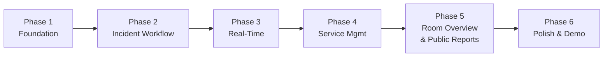

# ATHITHI
## Product Requirements Document (PRD)

**Product:** Athithi — Guest Safety & Hospitality Coordination Platform  
**Tagline:** Athithi Devo Bhava. Their safety, our responsibility.  
**Version:** 1.0 — Hackathon MVP  
**Status:** Ready for development  
**Problem Statement:** Hospitality Crisis Coordination Platform  
**SDG Alignment:** SDG 11 — Sustainable Cities and Communities

---

## 1. Product Overview

### 1.1 Vision

Athithi is a centralised hospitality safety and service coordination platform that connects hotel guests, hotel staff, administrators, and members of the public through a unified incident-reporting and task-management system.

The platform enables guests to report emergencies and routine service issues without relying exclusively on telephone calls or physical visits to the reception. Administrators can monitor incidents, assign appropriate personnel, escalate unresolved situations, and track requests until closure.

Staff members receive actionable assignments and provide status updates throughout the response process.

### 1.2 Problem Statement

Traditional hospitality facilities often rely on telephone calls, reception desks, and disconnected communication channels to handle emergencies and routine guest requests.

This creates several problems:

- Emergency reports may not reach the appropriate personnel quickly.
- Administrators may lack a consolidated view of active incidents.
- Staff assignments and acknowledgements may not be tracked systematically.
- Guests have limited visibility into the progress of their requests.
- Routine maintenance and housekeeping requests may be forgotten or delayed.
- There may be no reliable, centralised history of incidents, response actions, and resolutions.
- External people who witness a hazard near or inside a hospitality facility may lack a convenient reporting channel.

### 1.3 Proposed Solution

Athithi provides a shared digital coordination system consisting of four interfaces:

1. **Guest Portal:** Emergency SOS, service requests, request tracking, and guest notifications.
2. **Staff Portal:** Assigned tasks, acknowledgement, response updates, and resolution records.
3. **Admin Command Centre:** Incident monitoring, hotel room overview, staff assignment, escalation, and operational analytics.
4. **Public Reporting Portal:** Restricted reporting of hazards and potential emergencies by people without a guest account.

All interfaces communicate with one backend and share a consistent incident and task record.

---

## 2. Product Goals

### Primary goals

1. Reduce unnecessary communication delays between guests, administrators, and staff.
2. Provide a clear workflow for reporting, assigning, tracking, escalating, and resolving emergencies.
3. Centralise routine hotel service requests and make their status visible.
4. Give administrators a real-time overview of active incidents and outstanding tasks.
5. Maintain a timestamped audit trail of important actions.
6. Demonstrate a complete, functional, multi-role coordination workflow during the hackathon.

### Success criteria

The prototype should demonstrate that:

- A guest can submit an SOS alert and the administrator can see it without refreshing the dashboard.
- An administrator can assign a responder and the responder receives the assignment.
- A responder can acknowledge and update the task status.
- The administrator can monitor the response and record the resolution.
- A guest can submit a routine service request and track its progress.
- Unacknowledged tasks can be flagged and escalated.
- Public users can report incidents without accessing private hotel data.
- The system records meaningful timestamps and status changes.

### Non-goals

The MVP will not attempt to:

- Replace official emergency services or certified fire-alarm systems.
- Automatically dispatch real ambulances, fire engines, or police.
- Determine whether a person is physically inside a hotel room without a reliable data source.
- Guarantee that all occupants have evacuated safely.
- Provide real-time indoor positioning without supporting hardware.
- Implement a full hotel property-management or reservation system.
- Provide food ordering, restaurant reservations, or tourist itinerary planning.
- Build a native Android or iOS application.

---

## 3. Target Users and Roles

### 3.1 Guest

A guest is a person currently staying at the hotel.

**Capabilities:**
- Access the guest portal through a secure check-in invitation, QR code, or temporary access link.
- View a prominent emergency SOS action.
- Submit an emergency report.
- Select an incident category and provide optional details or photographs.
- Submit maintenance, housekeeping, and amenity requests.
- View the status and history of their own requests.
- Receive incident and service-request updates.
- Access basic hotel emergency instructions.

**Restrictions:**
- Cannot access the administrator dashboard.
- Cannot view another guest's personal information or requests.
- Cannot issue official hotel-wide alerts.
- Cannot assign staff or alter incident severity on the server.
- Access expires according to the configured checkout policy.

### 3.2 Staff / Responder

An authorised hotel employee responsible for responding to assigned tasks.

**Capabilities:**
- Sign in using an authorised staff account.
- View assigned incidents and service requests.
- Receive new assignment notifications.
- Acknowledge or decline an assignment with a reason.
- Update status to En Route, On Scene, In Progress, or an appropriate terminal state.
- Add progress notes and resolution details.
- Request assistance or escalate an incident.
- View relevant location information and response instructions.

**Restrictions:**
- Cannot access unrestricted guest records.
- Cannot assign tasks to other employees unless authorised.
- Cannot close critical incidents without the required control-room verification.
- Cannot alter the incident audit history.

### 3.3 Administrator / Control Room Operator

The authorised operator responsible for monitoring hotel operations and coordinating responses.

**Capabilities:**
- View all authorised hotel incidents and service requests.
- View room occupancy records and room-level operational information.
- Open incident details and review their event timeline.
- Assign and reassign staff.
- Set or adjust priority according to defined rules.
- Send guest-facing updates and authorised alerts.
- Monitor task acknowledgements and response times.
- Escalate overdue requests.
- Record external emergency-service contact and handover details.
- Verify and close critical incidents.
- Review audit records and operational analytics.

**Restrictions:**
- Access is controlled by server-side permissions.
- Sensitive guest information is shown only when operationally necessary.
- Critical actions are recorded in the audit log.

### 3.4 Public Reporter

A person who is not authenticated as a hotel guest or employee.

**Capabilities:**
- Open a publicly accessible reporting page.
- Select an incident category.
- Submit a description and approximate location.
- Optionally attach a photograph.
- Receive a submission reference.

**Restrictions:**
- Cannot access room occupancy, guest records, internal task assignments, or staff locations.
- Cannot issue official evacuation instructions.
- Reports are treated as unverified until reviewed.
- Submission frequency and attachment size are limited to reduce abuse.

---

## 4. Functional Requirements

Priority definitions:

- **P0:** Essential for the MVP and live demonstration.
- **P1:** Important enhancement after the core workflow is stable.
- **P2:** Future development.

### 4.1 Authentication and Access Control

**FR-001 — Role-based authentication (P0)**  
The system shall authenticate guests, staff, and administrators and enforce role-based permissions on the backend.

**FR-002 — Guest access lifecycle (P0)**  
The system shall support secure guest access associated with a hotel stay. Access shall be revocable and expire at checkout or when an authorised administrator terminates it.

**FR-003 — Staff and administrator accounts (P0)**  
Staff and administrator accounts shall be provisioned through an authorised process. Public registration shall not grant privileged roles.

**FR-004 — Public reporting access (P0)**  
The public reporting page shall allow restricted report submission without revealing internal hotel information.

**FR-005 — Session security (P0)**  
Authentication secrets and tokens shall not be stored in plaintext. Protected routes and API operations shall enforce permissions independently of frontend navigation.

### 4.2 Emergency SOS and Incident Reporting

**FR-006 — Prominent SOS action (P0)**  
The guest dashboard shall display a clearly identifiable emergency SOS control, accessible without navigating through other pages.

**FR-007 — Immediate alert creation (P0)**  
Activating SOS shall immediately create a high-priority incident and notify the control room. Selecting an incident category shall not be required before the initial alert.

**FR-008 — Incident categorisation (P0)**  
The guest shall be able to select one of the following categories:
- Fire or smoke
- Medical emergency
- Electrical hazard
- Water leakage or flooding
- Security or personal safety threat
- Structural hazard
- Other / Unknown

**FR-009 — Incident details (P0)**  
The incident record shall capture: unique identifier, reporter identity, associated hotel and room, incident category, description, creation timestamp, current status and priority, assigned responder, attachment references, and event history.

**FR-010 — Media attachments (P1)**  
Users may attach photographs where appropriate. Uploads shall be validated, size-limited, and access-controlled. Capturing or uploading media shall never be required to submit an emergency alert.

**FR-011 — Incident updates (P0)**  
Guests shall receive relevant status updates for their own reports. Administrators shall be able to add authorised updates to an incident.

**FR-012 — Accidental activation handling (P1)**  
The interface may provide a short cancellation mechanism for accidental SOS activation, but it shall not delay the initial alert. Cancellations shall be recorded and communicated to the control room.

### 4.3 Incident Coordination

**FR-013 — Live incident dashboard (P0)**  
New incidents and subsequent updates shall appear in the administrator dashboard without a manual page refresh.

**FR-014 — Incident prioritisation (P0)**  
The system shall support Critical, High, Medium, and Low priorities. Initial emergency SOS reports shall be surfaced immediately.

**FR-015 — Staff assignment (P0)**  
Administrators shall be able to assign an incident to an eligible staff member. Assignment records shall include the assignee, assigning operator, timestamp, and relevant instructions.

**FR-016 — Assignment acknowledgement (P0)**  
Staff shall acknowledge or decline assignments. Declines shall require a reason. Unacknowledged assignments shall be visible to administrators.

**FR-017 — Response status tracking (P0)**  
Incident lifecycle: `Reported → Acknowledged → Assigned → Responding → In Progress → Resolved → Closed`  
Additional states: Escalated, Cancelled, Reopened. State transitions shall be validated on the backend.

**FR-018 — Escalation rules (P0)**  
Administrators shall be able to configure acknowledgement deadlines and escalation rules. When an assignment exceeds its deadline, the system shall flag it and notify the designated operator or backup.

**FR-019 — External emergency-service coordination (P0)**  
The administrator interface shall support recording whether an external emergency service was contacted, the contact timestamp, the service type, the operator, and any reference or handover details.

**FR-020 — Incident closure (P0)**  
Resolution shall require an outcome or resolution note. Critical incidents shall require the configured authorisation or verification step before closure.

### 4.4 Guest Service Requests

**FR-021 — Service request submission (P0)**  
Supported request categories:
- Maintenance and plumbing
- Electrical or appliance issues
- Housekeeping and cleanliness
- Extra blankets, pillows, towels, or beds
- General assistance or complaints

**FR-022 — Request details (P0)**  
A service request shall contain: unique identifier, requester, room/location, category, description, creation timestamp, priority, status, and assignment history.

**FR-023 — Service request assignment (P0)**  
Administrators shall be able to route requests to appropriate staff categories.

**FR-024 — Service request tracking (P0)**  
Guest-visible statuses: `Submitted → Assigned → In Progress → Resolved → Closed`

**FR-025 — Service deadlines (P1)**  
Administrators shall be able to configure expected response deadlines by category and priority. Overdue requests shall be flagged.

**FR-026 — Unified operations queue (P0)**  
The administrator shall monitor emergency incidents and routine service requests from a common interface, with clear visual and operational separation.

### 4.5 Hotel Room Overview

**FR-027 — Room and floor overview (P0)**  
The administrator dashboard shall display a visual representation of hotel floors and rooms, using seeded demo data.

**FR-028 — Room details (P0)**  
Room detail view: room number and floor, booking/occupancy status, check-in and checkout dates, open service requests, active incidents, and operational history.

**FR-029 — Occupancy versus physical presence (P0)**  
The system shall distinguish booking status from actual physical presence. Unknown physical presence shall be represented as Unknown.

**FR-030 — Room data integrity (P0)**  
The MVP shall use a seeded dataset. The interface shall not present fabricated room or presence information as live hotel-system data.

### 4.6 Staff Operations

**FR-031 — Staff task inbox (P0)**  
Staff shall have a task list showing priority, incident type, location, creation time, and current status.

**FR-032 — Task progress updates (P0)**  
Staff shall be able to record acknowledgement, progress, findings, blockers, and resolution notes.

**FR-033 — Reassignment and support (P1)**  
Authorised staff shall be able to request assistance. Administrators shall be able to reassign tasks while preserving original assignment history.

### 4.7 Public Reporting

**FR-034 — Public report submission (P0)**  
Public users shall be able to submit an incident category, description, approximate location, and optional photograph.

**FR-035 — Public report triage (P0)**  
Public reports shall enter a review queue with Unverified status. An authorised operator shall be able to assess, escalate, link to an existing incident, or dismiss with a reason.

**FR-036 — Abuse prevention (P0)**  
Public submissions shall have rate limits, server-side validation, attachment restrictions, and basic abuse controls.

### 4.8 Notifications and Audit History

**FR-037 — Real-time updates (P0)**  
The application shall use authenticated real-time connections or an equivalent mechanism to notify authorised clients of relevant changes.

**FR-038 — Notification acknowledgement (P0)**  
The system shall distinguish between notification created, delivered, and explicitly acknowledged.

**FR-039 — Audit log (P0)**  
Important actions shall be recorded with actor, action, entity, timestamp, and change details. Audit records shall be protected against modification.

**FR-040 — AI situation summaries (P1)**  
The system may generate incident summaries from existing records. AI output shall not autonomously issue evacuation instructions, determine physical safety, or close incidents.

---

## 5. Core User Workflows

### Workflow A — Guest Emergency
1. Guest opens the authenticated guest portal.
2. Guest activates SOS.
3. Backend creates a Critical-priority incident and records the timestamp.
4. Control room receives the incident through the real-time channel.
5. Guest is prompted to select an incident type and optionally provide additional details.
6. Administrator reviews the report and assigns an appropriate responder.
7. Staff member acknowledges the assignment.
8. Staff updates response progress.
9. Administrator records any external emergency-service contact.
10. Guest receives relevant status updates.
11. Responder records findings and resolution.
12. Authorised operator verifies and closes the incident.
13. The complete event history remains available for audit.

### Workflow B — Routine Service Request
1. Guest opens the Service Requests section.
2. Guest selects a category and describes the issue.
3. Backend creates a service request.
4. Administrator sees the request in the operations queue.
5. Administrator assigns it to the appropriate staff member.
6. Staff acknowledges and begins the task.
7. Guest can view the current status.
8. Staff records work performed and marks the request resolved.
9. Request history is retained.

### Workflow C — Public Incident Report
1. Public user opens the reporting page.
2. User selects a category and enters a description and approximate location.
3. User optionally attaches a photograph.
4. Backend validates and stores the report.
5. Administrator receives an unverified report notification.
6. Administrator assesses and either escalates, links to an existing incident, requests more information, or dismisses with a reason.

### Workflow D — Unacknowledged Assignment
1. Administrator assigns a task.
2. The assigned staff member does not acknowledge it within the configured deadline.
3. The backend flags the assignment as overdue.
4. The control room receives an escalation notification.
5. An authorised operator contacts the staff member or reassigns the task.
6. The original assignment and escalation history remain recorded.

---

## 6. User Interface and Page Architecture

### Public Pages
- Landing / Sign-in Page
- Public Incident Reporting Page
- Public Report Confirmation Page

### Guest Pages
- Guest Dashboard
- Emergency Report Details
- Service Request Form
- My Requests
- Request / Incident Details
- Guest Notifications
- Hotel Emergency Information

### Staff Pages
- Staff Dashboard
- Assigned Task Details
- Task Progress Update
- Task History / Completed Tasks

### Admin Pages
- Admin Overview
- Incident Command Centre
- Incident Details and Timeline
- Staff Assignment Interface
- Unified Service Requests Queue
- Hotel Floor Plan / Room Overview
- Room Details
- Public Reports Review Queue
- Notification Centre
- Audit History and Basic Analytics
- Basic Staff and Configuration Management

### UI Principles
- Mobile-first design for guest and staff interfaces.
- Desktop-optimised control room dashboard.
- Large, clearly labelled emergency controls.
- High contrast, readable typography, and accessible touch targets.
- Text labels in addition to colour-coded statuses.
- Minimal steps for emergency reporting.
- Consistent components for cards, status badges, dialogs, tables, and forms.
- Clear distinction between emergency incidents and routine requests.
- Loading, empty, error, offline, and reconnection states for all important workflows.

---

## 7. Non-Functional Requirements

### Performance
- Target near-real-time updates for connected clients under normal conditions.
- Target backend response time of under 500 ms at the 95th percentile for ordinary database-backed operations.
- The dashboard shall avoid unnecessary full-page reloads.

### Security and Privacy
- Enforce server-side role-based access control.
- Validate all API inputs.
- Use secure authentication and session handling.
- Restrict access to guest information and uploaded media.
- Do not expose private records through predictable identifiers.
- Apply rate limiting to authentication and public-reporting endpoints.
- Store passwords only using an appropriate password-hashing algorithm.
- Use environment variables for secrets and keep credentials out of source control.
- Maintain an audit trail for sensitive operations.
- Use fictional data in the hackathon demonstration.

### Reliability
- Persist incidents and requests in the database.
- Do not rely solely on browser state or transient socket events.
- On reconnection, clients shall retrieve the latest authoritative state.
- Failed notification delivery shall not erase the underlying incident.
- Critical workflows shall provide a visible fallback if the real-time connection is lost.

### Accessibility
- Support keyboard navigation.
- Provide descriptive labels for form controls.
- Do not rely on colour alone to communicate priority.
- Support readable text and screen-reader-friendly status messages.
- Avoid unnecessary animations that delay emergency reporting.

---

## 8. Technology Stack

| Layer | Technology |
|---|---|
| Frontend | React, Vite, Vanilla CSS, React Router |
| HTTP | Fetch API |
| Real-time | Socket.IO Client |
| Backend | Node.js, Express, Socket.IO |
| ORM | Prisma |
| Database | PostgreSQL |
| Optional | LLM API (summaries), Object storage (images) |

> [!IMPORTANT]
> The core application shall work without an AI API. Do not make SOS creation, staff assignment, or incident closure dependent on a generative model.

---

## 9. Initial Database Model

| Entity | Key Fields |
|---|---|
| **User** | id, name, email/phone, passwordHash, role, accountStatus, createdAt |
| **Hotel** | id, name, address, configSettings |
| **Room** | id, hotelId, roomNumber, floor, roomType, operationalStatus |
| **Stay** | id, guestId, roomId, checkInAt, scheduledCheckoutAt, actualCheckoutAt, status |
| **Incident** | id, hotelId, reporterId, stayId, roomId, publicReporterRef, category, description, priority, verificationStatus, incidentStatus, createdAt, resolvedAt, closedAt |
| **ServiceRequest** | id, hotelId, guestId, stayId, roomId, category, description, priority, status, createdAt, resolvedAt |
| **Assignment** | id, incidentId OR serviceRequestId, assigneeId, assignedById, assignmentStatus, assignedAt, acknowledgedAt, completedAt, declineReason |
| **IncidentEvent** | id, incidentId, actorId, eventType, description, metadata, createdAt |
| **ServiceRequestEvent** | id, serviceRequestId, actorId, eventType, description, createdAt |
| **Attachment** | id, incidentId OR serviceRequestId, uploadedById, storageKey, contentType, fileSize, createdAt |
| **Notification** | id, recipientId, incidentId OR serviceRequestId, notificationType, deliveryStatus, acknowledgedAt, createdAt |
| **AuditLog** | id, actorId, action, entityType, entityId, changeSummary, createdAt |

> [!NOTE]
> Store all timestamps in UTC. Use stable identifiers, not room numbers, as primary keys. Derive occupancy from authoritative stay records. Enforce referential integrity and validate permitted status transitions.

---

## 10. API Design

### Authentication
| Method | Endpoint |
|---|---|
| POST | `/api/auth/login` |
| POST | `/api/auth/logout` |
| GET | `/api/auth/me` |

### Guest
| Method | Endpoint |
|---|---|
| POST | `/api/incidents/sos` |
| POST | `/api/incidents` |
| GET | `/api/incidents/mine` |
| GET | `/api/incidents/:id` |
| POST | `/api/service-requests` |
| GET | `/api/service-requests/mine` |
| GET | `/api/service-requests/:id` |

### Staff
| Method | Endpoint |
|---|---|
| GET | `/api/staff/tasks` |
| POST | `/api/assignments/:id/acknowledge` |
| POST | `/api/assignments/:id/decline` |
| PATCH | `/api/assignments/:id/status` |
| POST | `/api/incidents/:id/events` |
| POST | `/api/service-requests/:id/events` |

### Administrator
| Method | Endpoint |
|---|---|
| GET | `/api/admin/overview` |
| GET | `/api/admin/incidents` |
| GET | `/api/admin/service-requests` |
| GET | `/api/admin/rooms` |
| GET | `/api/admin/rooms/:id` |
| POST | `/api/admin/incidents/:id/assign` |
| POST | `/api/admin/service-requests/:id/assign` |
| POST | `/api/admin/incidents/:id/escalate` |
| POST | `/api/admin/incidents/:id/close` |
| GET | `/api/admin/public-reports` |
| POST | `/api/admin/public-reports/:id/review` |
| GET | `/api/admin/audit-logs` |

### Public
| Method | Endpoint |
|---|---|
| POST | `/api/public/reports` |

### Real-time Socket Events
`incident:created` · `incident:updated` · `incident:assigned` · `assignment:created` · `assignment:acknowledged` · `assignment:escalated` · `service-request:created` · `service-request:updated` · `notification:created`

> [!CAUTION]
> Socket rooms and event payloads shall be scoped by role, hotel, and resource permissions. A client must not be allowed to join arbitrary rooms simply by supplying an identifier.

---

## 11. Development Phases

| Phase | Focus | Done When |
|---|---|---|
| **1** | Project setup, DB, auth, seed data | Authorised users can sign in and access only their permitted interfaces |
| **2** | SOS, incident creation, admin queue, assignment, timeline | SOS can be tracked from creation to closure across all three roles |
| **3** | Socket.IO, real-time broadcast, notifications, escalation, reconnection | A state change in one interface appears in others without refreshing |
| **4** | Service requests, assignment, guest tracking, resolution, audit | A routine request can be submitted, assigned, updated, and resolved end-to-end |
| **5** | Floor plan, room details, public reporting, attachments | Admins can navigate rooms and review public reports without exposing private data |
| **6** | Responsive polish, a11y, demo data reset, AI summaries (optional), rehearsal | Application completes the planned demonstration reliably |

---

## 12. Acceptance Test Checklist

### Authentication
- [ ] Guests cannot access administrator endpoints.
- [ ] Staff cannot access unauthorised guest records.
- [ ] Public users cannot retrieve internal room or incident data.
- [ ] Guest access expires or is revoked according to the stay lifecycle.

### Emergency workflow
- [ ] SOS creates an incident without requiring a category first.
- [ ] The incident appears in the administrator queue.
- [ ] The administrator can assign an eligible staff member.
- [ ] The staff member can acknowledge or decline the assignment.
- [ ] The administrator can see the acknowledgement and subsequent updates.
- [ ] An overdue assignment is flagged and escalated.
- [ ] Resolution details are stored.
- [ ] The audit timeline records important actions.

### Service requests
- [ ] A guest can submit each supported request category.
- [ ] The request appears in the administrator queue.
- [ ] The administrator can assign the request.
- [ ] The assigned staff member can update progress.
- [ ] The guest can see the request status.
- [ ] The resolved request remains available in history.

### Hotel overview
- [ ] Rooms can be selected from the floor overview.
- [ ] Room details show authoritative booking or stay data.
- [ ] Unknown physical presence is not presented as confirmed presence.
- [ ] Active incidents associated with a room are visible to authorised users.

### Public reporting
- [ ] Public users can submit a report without logging in.
- [ ] Public reports enter an unverified review queue.
- [ ] Public users cannot access internal reports or private guest data.
- [ ] Invalid and oversized uploads are rejected.

### Reliability
- [ ] Updates appear in real time for connected clients.
- [ ] Reconnecting clients recover the latest database-backed state.
- [ ] Failure of the notification channel does not erase an incident.
- [ ] Critical workflows have visible failure and fallback states.
- [ ] All core features work without an AI provider.

---

## 13. Risks and Mitigations

| Risk | Mitigation |
|---|---|
| Project becomes too broad | Complete emergency and service-request workflows before adding optional features |
| Real-time mistaken for guaranteed delivery | Distinguish persisted incidents, notification delivery, and explicit acknowledgement |
| Public reports contain false or malicious information | Rate limiting, validation, restricted uploads, unverified status, admin triage |
| Guests believe the website replaces emergency services | Display clear instructions to use official emergency channels |
| Sensitive guest information exposed | Server-side RBAC, minimal data collection, secure sessions, protected attachments |
| AI invents facts or unsafe instructions | Restrict AI to summarisation only; require authorised human decisions for emergency actions |
| Demonstration depends on external systems | Use deterministic seeded dataset and simulated integrations clearly labelled |
| Staff receive inappropriate assignments | Define eligible responders; route emergencies through approved procedures |

---

## 14. Hackathon Demonstration Plan

1. A guest reports smoke through the SOS interface.
2. The administrator dashboard receives the incident immediately.
3. The administrator reviews the report and assigns an eligible responder.
4. The responder acknowledges the task and updates the status.
5. The administrator monitors the incident timeline and records an external-service contact (simulated).
6. A second assignment remains unacknowledged — demonstrating escalation.
7. The guest receives an update.
8. The responder records the outcome and the administrator closes the incident.
9. A different guest submits a broken-tap request.
10. The administrator assigns maintenance and the guest tracks the request through resolution.
11. A public user submits a potential hazard report, which appears in the unverified review queue.
12. The team demonstrates the audit trail and summarises the operational benefits.

> [!NOTE]
> The demo shall use fictional guests, rooms, staff, and incidents. Simulated integrations must be labelled clearly.

---

## 15. Future Roadmap

- SMS and WhatsApp notifications through verified providers.
- Integration with hotel property-management systems.
- Verified fire-alarm and building-management integrations.
- Multilingual guest communication.
- Accessible evacuation information based on approved building procedures.
- AI-generated situation briefings with source references.
- Advanced response-time and service-quality analytics.
- Food ordering and pre-booking.
- Tourist recommendations and local itinerary planning.
- Multi-hotel administration and organisation-level management.

> [!CAUTION]
> Future features must not compromise the reliability or simplicity of the core emergency workflow.

---

## 16. Product Success Definition

Athithi is considered a successful hackathon MVP when it demonstrates a working, persistent, role-restricted coordination workflow connecting guests, staff, and administrators.

The product must show that:
- Reports are captured.
- Responsible people are assigned.
- Acknowledgements and progress are tracked.
- Unresolved tasks are surfaced.
- Guests receive appropriate updates.
- Outcomes are recorded.
- Public users can report hazards without accessing private hotel information.

---

> **Central product principle:**
>
> *Every report should have a clear status. Every actionable task should have an owner. Every critical action should be traceable.*
>
> Athithi exists to make hospitality incidents and service requests more visible, coordinated, and accountable — not to replace trained responders or guarantee safety through software alone.
